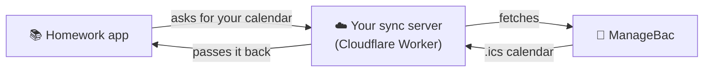

<div align="center">

# 📚 Homework

**Every assignment, in one calm place.**

A clean, fast homework planner for students. Track deadlines, color-code your classes,<br>
and sync assignments straight from ManageBac, all without installing anything.


<br>


[Features](#-features) •
[Screenshots](#-screenshots) •
[Quick start](#-quick-start) •
[ManageBac sync](#-managebac-sync) •
[How it works](#-how-it-works) •
[Roadmap](#-roadmap)

<br>


</div>

<br>

## ✨ Features

<table>
<tr>
<td width="50%" valign="top">

### 🗓️ Plan your week
- **Dashboard** with your week at a glance
- **Calendar** month view, click any day to add work
- Smart groups: *Overdue, Today, Tomorrow, This week, Later*
- Friendly countdowns like "Due Friday" or "2 days late"

</td>
<td width="50%" valign="top">

### 🎨 Stay organized
- **Color-coded classes**, each with its own page
- **Side panel editor** for notes, dates and ⭐ important tasks
- **Search** across titles, classes and notes
- **Light and dark mode**

</td>
</tr>
<tr>
<td width="50%" valign="top">

### 🔄 Sync with school
- **Automatic ManageBac sync** when you open the app
- Teacher changes a date? It updates by itself
- Your checkmarks and notes are never overwritten

</td>
<td width="50%" valign="top">

### 🔐 Accounts
- **Sign up and log in** screens
- Passwords hashed with **PBKDF2** (never stored as text)
- Separate accounts for everyone sharing a computer

</td>
</tr>
</table>

**Also:** works on phones, tablets and computers • keyboard shortcuts • backup download • zero dependencies

<br>

## 📸 Screenshots

<div align="center">

| Dark mode | Calendar |
| :---: | :---: |
|  |  |
| **Assignment editor** | **Log in** |
|  |  |


*Fully responsive, with a slide-out menu on phones.*

</div>

<br>

## 🚀 Quick start

No installs, no terminal, no build tools.

```bash
git clone https://github.com/YOUR-USERNAME/homework-tracker.git
```

1. Download or clone the project and **extract it** if it's a zip.
2. Open **`index.html`** in Chrome, Edge or Firefox.
3. **Create an account** and add your first assignment.

> [!TIP]
> Seeing a page that says "The app couldn't start"? You probably opened `index.html` from inside the zip.
> Extract the folder first, and keep `css/` and `js/` next to `index.html`.

### 🌍 Put it online for free

1. Push the project to GitHub.
2. Go to **Settings → Pages**.
3. Choose branch **`main`** and folder **`/ (root)`**, then **Save**.
4. Your app is live at `https://YOUR-USERNAME.github.io/homework-tracker/` 🎉

<br>

## 🔄 ManageBac sync

Paste your ManageBac calendar link once, and new assignments show up by themselves.



Browsers block websites from reading other websites directly, so a tiny free server
(`worker/worker.js`) fetches the calendar for you. It **only** accepts ManageBac links and saves nothing.

**➡️ Full step-by-step setup: [SYNC-SETUP.md](SYNC-SETUP.md)**

> [!WARNING]
> Your ManageBac calendar link is **private**, like a password to your schedule.
> Never commit it to GitHub or share it. The app only stores it in your own browser.

<br>

## ⌨️ Keyboard shortcuts

| Key | Action |
| :---: | --- |
| <kbd>N</kbd> | New assignment |
| <kbd>/</kbd> | Search |
| <kbd>Esc</kbd> | Close panel or menu |

<br>

## 🛠️ How it works

<details>
<summary><b>📁 Project structure</b></summary>

<br>

```text
homework-tracker/
├── index.html          # Page structure: login, sidebar, top bar, side panel
├── css/
│   └── style.css       # All styling, dark mode and phone layouts
├── js/
│   ├── helpers.js      # Building elements, icons, dates, toasts
│   ├── auth.js         # Sign up, log in, password hashing
│   ├── managebac.js    # Reading ManageBac calendar (.ics) files
│   └── app.js          # Pages, classes, assignments, settings, syncing
├── worker/
│   └── worker.js       # Free Cloudflare sync server
├── docs/               # Screenshots for this README
├── SYNC-SETUP.md       # ManageBac setup guide
└── LICENSE
```

</details>

<details>
<summary><b>💾 How data is saved</b></summary>

<br>

Everything is stored in the browser with `localStorage`, under one key per account.
An assignment looks like this:

```json
{
  "id": "lq3x9ab2",
  "title": "Essay draft",
  "subject": "English",
  "due": "2026-10-30",
  "important": false,
  "done": false,
  "notes": "800 words",
  "source": "managebac",
  "uid": "12345@managebac"
}
```

Imported assignments keep their ManageBac `uid`, so the next sync knows which ones to update.

</details>

<details>
<summary><b>🔐 How accounts work, and their limits</b></summary>

<br>

When you sign up, the app creates a random **salt** and scrambles your password with
**PBKDF2** (150,000 rounds of SHA-256). Only the scrambled result is saved, never the password itself.
Logging in scrambles what you typed the same way and compares.

**Good to know:**

- ✅ Several people can share one computer, each with their own assignments
- ⚠️ Accounts only exist on the **device and browser** where they were created
- ⚠️ It isn't full security: someone with access to the computer could still read saved assignments

For accounts that work on any device, the next step would be a backend like
[Supabase](https://supabase.com) or [Firebase](https://firebase.google.com).
Storing other people's data is a real responsibility, so learn about privacy and security first.

</details>

<details>
<summary><b>🏫 Class names look wrong after syncing?</b></summary>

<br>

Every school's calendar is a little different. The app guesses the class from titles like
`Math: Problem set` or `[Math] Problem set`. To match your school, edit the
`subjectAndTitle()` function in [`js/managebac.js`](js/managebac.js).

</details>

<br>

## 🗺️ Roadmap

- [x] Assignments with due dates and smart grouping
- [x] Color-coded classes
- [x] Calendar view
- [x] Light and dark mode
- [x] Accounts with hashed passwords
- [x] Automatic ManageBac sync
- [ ] Real online accounts with Supabase
- [ ] Reminders the day before something is due
- [ ] Drag assignments between days in the calendar
- [ ] Focus timer for working on an assignment
- [ ] Google Classroom support

<br>

## 🤝 Contributing

Ideas and improvements are welcome!

1. Fork the repo
2. Create a branch: `git checkout -b my-feature`
3. Commit your changes: `git commit -m "Add my feature"`
4. Push and open a pull request

<br>

## 📄 License

Released under the [MIT License](LICENSE). Free to use, change and share.

<div align="center">
<br>

Made with ☕ and too many deadlines.

**If this helped you, consider giving it a ⭐**

</div>
